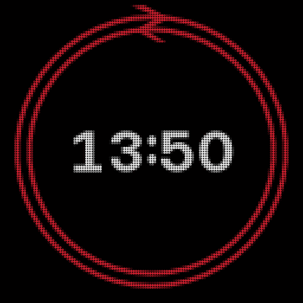
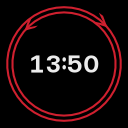
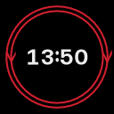
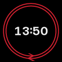
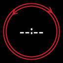
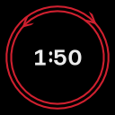

# Rail Clock for the Art Matrix

A plugin for [Pimoroni's Art Matrix](https://github.com/pimoroni/artmatrix) (128×128 RGB
LEDs): the station clock from my Tufty 2350
([statsbadge-railclock](https://github.com/vwillcox/statsbadge-railclock)), filling the
matrix.



The time sits inside two red rings, and each ring carries one chevron of the double arrow.
The outer chevron goes round clockwise and the inner one anticlockwise, a turn a minute
each. They meet as the double arrow at the top on the minute, and at the bottom on the
half minute.

The geometry, colours and font are the Tufty page's, which follow Network Rail's Rail
Clock (Design Bridge and Partners, 2025) as FireTVDeparture's clock tile draws it. The
200-unit drawing is scaled so the outer chevron's arm stops 2 px from the edge. That puts
the rings at radii of 56.8 and 51.6 px with a 2.1 px stroke, and the digits about 18 px
tall.

| On the minute | :07 | :15 | Half minute | Before NTP | 12-hour |
|---|---|---|---|---|---|
|  |  |  |  |  |  |

## How it differs from the Tufty page

- **Time:** the Art Matrix firmware sets the RTC (UTC) from NTP and picks the zone on its
  settings page, so the plugin works out local time with the firmware's `timezones`
  module. It needs nothing from a host. It shows `--:--` while the RTC still holds its
  power-on date (before 2025). The chevrons sweep smoothly off `ticks_ms()` within each
  second.
- **No tile:** the whole matrix is the face. The background defaults to black, which
  leaves those LEDs off.
- **Settings** (on the plugin's config page): ring, time and background colours, and a
  12-hour option.
## Speed

Only the chevrons move, so a frame does only that work:

- The background, rings and time live in a 128×128 face image. The time is redrawn into
  it once a minute.
- Each frame blits the face back into the boxes the two chevrons covered last frame
  (about 20×20 px each), then draws the chevrons again. The boxes come from a table with
  one entry per degree of turn, built as the chevrons first pass each degree.
- The whole face is copied in only when the firmware hands over a surface that doesn't
  hold the clock's last frame. The firmware clears a surface to black whenever it passes
  to another plugin, so the clock leaves a marker in the alpha byte of its top-left
  pixel, which the panel ignores. If the marker has gone, the surface is repainted.
- The per-frame functions are `@micropython.native`, as Pimoroni's own clocks are.

`tools/preview.py` checks that this is exact. Over 930 frames, including a minute change,
a firmware-style clear and a switch to 12-hour, the frame built this way matches the same
frame drawn whole, byte for byte.

Measured on an Art Matrix (firmware v1.0.0):

| | Per frame (median) | Draw + flip loop |
|---|---|---|
| First version (whole face blitted each frame) | 4.35 ms | ~142 FPS |
| Now | **0.81 ms** (p95 0.87 ms) | **~286 FPS** |

Inside the firmware's own loop, with crossfades and the web server running, the clock
holds **~225–230 FPS** (~190 FPS for the first moments of each turn on screen, under the
crossfade and name label). The panel refreshes at ~208–318 Hz. While the firmware has no
internet it draws a Wi-Fi warning over every frame, and saving the pixels under that icon
pulls every plugin down to ~80 FPS. Import takes 166 ms and holds 78 kB of RAM. The
once-a-minute redraw of the time takes ~11 ms.

## Install

### Over USB

```bash
tools/deploy.sh /dev/ttyACM0     # needs mpremote; MPREMOTE=/path/to/mpremote to pick one
```

This copies `rail_clock/` to `/lib/plugins/rail_clock` and resets the board. The firmware
adds a new plugin folder switched off, so switch **Rail Clock** on at
`http://<name>.local`. (Thonny works too: make `/lib/plugins/rail_clock` and upload the
files, as in Pimoroni's
[GIF player guide](https://learn.pimoroni.com/article/play-gifs-on-art-matrix).)

Connecting with mpremote stops the running firmware, so reset the board afterwards
(`mpremote reset`, or the RESET button). A hard reset puts the RTC back to 2021, so the
clock shows `--:--` until the firmware gets the time from NTP again.

### From the catalogue

The install page only lists plugins in
[pimoroni/artmatrix-plugins](https://github.com/pimoroni/artmatrix-plugins). To offer it
there, put `rail_clock/` in that repository and run its `ci/generate_packages.py`, which
rewrites `package.json` (the hash and file list) and adds the plugin to `index.json`. It
passes that script's checks as it stands.

## Previewing without a matrix

`tools/preview.mjs` runs the plugin's own code under Pimoroni's badgeware WASM port (real
MicroPython, PicoVector and font rasteriser), on a 128×128 image, with the firmware's
`timezones` and `plugin_config`. It writes `shots/`, the GIF and `rail_clock/thumbnail.png`.

```bash
# once: the runtime and the firmware's Python modules, into build/
curl -fsSL -o build/runtime.zip https://github.com/pimoroni/badgeware-wasm/releases/download/v3.1.0/badgeware-tufty2350-batteries-jspi.zip
unzip -q build/runtime.zip -d build/badgeware-runtime
git clone --depth 1 https://github.com/pimoroni/artmatrix build/artmatrix

node tools/preview.mjs           # node 25+, ImageMagick
```

## The font

`railclock_digits.af` is the Tufty extension's: Inter at weight 700 and optical size 32,
with its tabular digits and raised colon, packed by statsbadge's `make_text_font.py`. See
that project's README to rebuild it. Inter is under the SIL Open Font License 1.1
(`rail_clock/OFL-Inter.txt`).

## Notes

This project is not affiliated with or endorsed by Network Rail or National Rail. The
double arrow symbol is a registered trademark.

The code is MIT licensed; the font is OFL-1.1.
